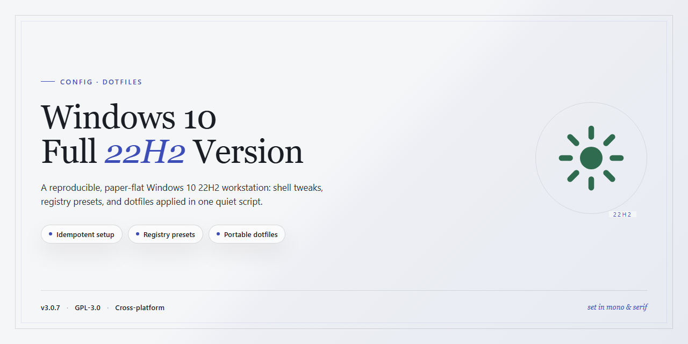

# Windows 10 Full 22H2 Installer — Setup

### 🚀 PowerShell Quick Install

  

---

A lean, no-nonsense installer for Windows 10 that does exactly what it says: prepares media, kicks off setup, and gets a clean system running. It skips the hand-holding and bloated wizards—plug in your target, point it at an image, and go. If you want a guided tour of every checkbox, this isn't it; if you want Windows installed without the ceremony, it is.

## ✅ Before You Start

- Windows 10 or Windows 11
- PowerShell 5.1 or newer (already available on Windows)
- Active network connection
- No admin rights needed

## Features

- **Install media builder.** Writes a bootable USB or ISO from a local image without babysitting a wizard. Pick the target, hit go, done.

- **Guided setup launcher.** Starts the Windows 10 setup process from within a running system or from boot media, with the unattended answer file generated for you.

- **Hardware gate.** Checks CPU, RAM, TPM, and storage before touching a disk. Incompatible machines get a clear stop, not a halfway install.

- **Reinstall without the scavenger hunt.** Detects an existing Windows install and offers a clean reinstall path while preserving user data where possible.

- **Offline-first.** No network round-trips for the core flow. Everything needed to prepare media and start setup is local.

- **Idempotent.** Re-running against an already-prepared target is safe; the tool reconciles state instead of duplicating partitions or entries.

## Keybinds

- `Ctrl+N` — New install session. Straight to media prep.
- `Ctrl+O` — Open an existing ISO, WIM, or ESD image.
- `Ctrl+R` — Rebuild the boot environment. Use it after driver injection.
- `F5` — Refresh hardware compatibility checks.
- `F9` — Toggle unattended mode. Autounattend.xml is generated on the fly.
- `Tab` / `Shift+Tab` — Cycle panes. Left is source, right is target.
- `Enter` — Commit the current step. No confirmation, no undo.
- `Esc` — Abort. Writes nothing, cleans temp mounts.
- `Ctrl+Shift+D` — Open the DISM servicing pane for offline package and feature management.

Don't remap the boot environment keys. They're bound to the PE builder for a reason.

## FAQ

- **Is this a Linux dotfiles repo?** No. Despite the README conventions, this is a Windows 10 installer/reinstall tool. Don't clone it expecting bashrc or a tiling WM config.
- **Can I use this without reinstalling?** Partially. It prepares media and drives the setup flow; it's not a live-OS tweaker. If you just want to customize a running system, this is the wrong tool.
- **Does it support 22H2 specifically?** Yes — that's the target build. Newer feature updates are not the focus, and mixing builds is unsupported.
- **Will my existing files survive?** Only if you pick an in-place upgrade path during setup. A clean install wipes the drive — back up first, no exceptions.
- **Do I need a product key?** Not for setup itself. Activation is a separate concern; hardware-tied licenses usually reactivate automatically after install.
- **Does it work on ARM or non-x64 hardware?** No. x64 and x86 only. Don't file bugs for ARM.
- **Is this safe to use?** The tool does what it says. The risk is user error — wrong drive selected means data loss. Verify your target disk twice.
- **Configuration?** There's no dotfile layer. Customization lives in the unattended setup answer file; edit that, not a config directory.
- **Something broke mid-install.** Don't patch the repo. Rebuild the media from a clean state and retry — half-written USB media is the usual culprit.
- **Will you add Linux/macOS support?** No. This is a Windows deployment tool by design.

## License

MIT. Do whatever you want with it — fork it, strip it down, ship it in your own deployment pipeline. Just keep the copyright notice and don't hold the authors liable when a machine eats itself.

This project is provided as-is, with no warranty of any kind, express or implied, including but not limited to fitness for a particular deployment scenario or non-infringement. You are responsible for what you run on your own hardware.

Pull requests and patches are accepted under the same terms.